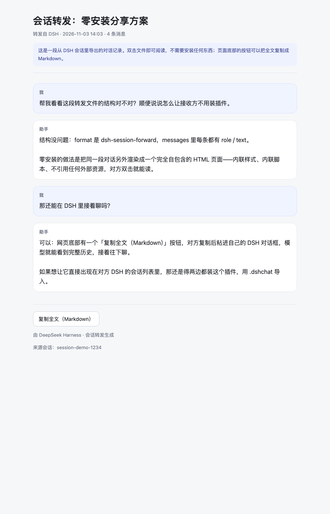
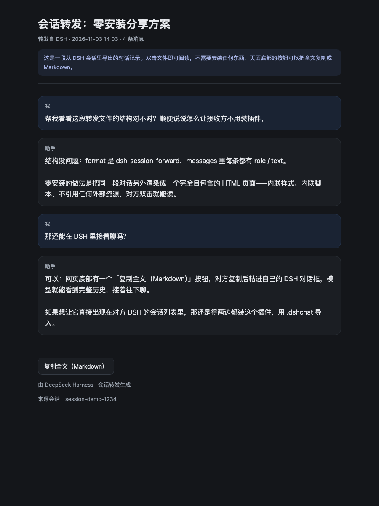

# 会话转发 · dsh-session-forward

把 DSH（DeepSeek Harness）里的一段对话交给别人：

- **复制一条链接**粘到微信 / 飞书，对方**什么都不用装**，点开就能读；
- 或者导出一张**自包含网页**，对方双击就能看，离线也行；
- 两边都装了本插件时，还能把对话**原样导入**成一条真实、可继续聊的会话。



## 为什么需要它

DSH 是跑在本机的应用：没有官方服务器托管的「分享页」，也没有原生的「导入会话」入口。所以这个插件做三件事，覆盖不同场景：

| 产物 | 接收方需要什么 | 得到什么 | 适用场景 |
|---|---|---|---|
| **分享链接** `http://192.168.x.x:PORT/s/<token>` | 什么都不用装，点开就行 | 24 小时有效的网页，可直接粘到微信/飞书 | 对方和你在**同一个 Wi-Fi / 局域网** |
| **网页记录** `xxx.dshchat.html` | 什么都不用装，双击用浏览器打开 | 完整排版的对话记录，可打印、可离线 | 对方在外网、或想把记录存档 |
| **会话文件** `xxx.dshchat.json` | 也装了本插件 | 在自己 DSH 里还原成一条**可以继续聊**的会话 | 两边都是 DSH 用户 |

三种产物的内容是一样的：只带走**看得见的对话文本**，工具调用、推理过程、图片附件不会跟着走（会告诉对方省略了多少）。

## 安装

**前提**：DSH `>= 0.2.1-rc.2 < 0.3.0`（插件靠 `engines.dsh` 做准入），以及 Git（从 GitHub 安装时用）。

### 方式一：从 GitHub 安装（推荐）

在 DSH 里直接跟 agent 说：

```
请用 plugin_manager 安装这个插件：
install_bundle target "github:apollodsh/dsh-session-forward"
```

安装完成后**重启 DSH**（宿主半边的 JS 与浏览器 bundle 都在启动时加载；只刷新页面不够）。

### 方式二：克隆下来，装本地目录

```bash
git clone https://github.com/apollodsh/dsh-session-forward.git
```

然后让 agent 安装这个**绝对路径**：

```
install_bundle target "/绝对路径/dsh-session-forward"
```

（本地目录是 `link:` 安装，改完代码重新构建/重启即可生效，适合自己改。）

### 方式三：加到「发现」页的插件市场索引

如果你的 DSH 打开了自定义插件市场（**插件 → 实验性插件 → 自定义插件市场**），
在 **发现 → 索引源** 里添加这个地址，然后搜索「会话转发」一键安装：

```
https://cdn.jsdelivr.net/gh/apollodsh/dsh-session-forward@main/market/index.json
```

（CDN 慢的话可以用 GitHub 原始地址：
`https://raw.githubusercontent.com/apollodsh/dsh-session-forward/main/market/index.json`）

### 方式四：npm（尚未发布）

发布到 npm 之后可以直接：

```
install_bundle target "dsh-session-forward"
```

## 使用

### 1. 分享链接（最省事）

1. 点会话标题右侧的**转发**图标；也可以在左侧会话列表中打开目标会话的「…」菜单，选择**转发**，无需切换当前会话；
2. 「转发本会话」→ **复制分享链接**（链接已经在剪贴板里，下方也会显示出来）；
3. 粘到微信 / 飞书发出去。对方点开就是排版好的对话记录；想接着聊，点页面底部「复制全文（Markdown）」，粘进自己的 DSH 对话框即可。

链接怎么来的：第一次点「复制分享链接」时，插件会在本机临时起一个 HTTP 服务（随机端口），只提供 `/s/<token>` 这一个路径。token 是 128 位随机串，默认 **24 小时**过期，最多同时保留 50 份；插件卸载或 DSH 退出就关闭，链接随之失效。第一次使用 macOS 可能弹一次「是否允许传入连接」，允许即可。

> ⚠️ **适用范围**：链接用的是你电脑的局域网地址，对方要和你连同一个 Wi-Fi/局域网才能打开。异地的对方请用下面的网页记录。

### 2. 网页记录（异地 / 离线）

1. 「转发本会话」→ **保存网页记录**，得到 `xxx.dshchat.html`；
2. 用微信/邮件/任何方式把文件发过去；
3. 对方双击就能在浏览器里读；同样可以「复制全文（Markdown）」回自己的 DSH 继续聊。

网页是**完全自包含**的：内联样式与脚本，不引用任何外部资源、不联网；深色/浅色跟随系统，可直接打印。



想先看看成品长什么样：[docs/demo.dshchat.html](docs/demo.dshchat.html)（下载后双击打开）。

### 3. 会话文件（双方都装插件）

1. 「保存会话文件（.dshchat）」→ 发给对方；
2. 对方在自己的 DSH 里点同一个按钮 →「打开别人转发的会话」→ 选文件 → 选目标工作区 → 导入。

导入会新建一条真实会话：标题沿用原会话，消息按 turn/step 结构写入日志，模型能看到这段历史，可以直接接着提问。

### 让 agent 代劳

插件注册了工具 `session_forward`，三种动作都能由模型触发：

| 动作 | 例子 | 结果 |
|---|---|---|
| `export` | 让 agent 把当前会话导出到某个路径 | 写出 `.dshchat.json` |
| `import` | 让 agent 导入某个 `.dshchat.json` | 新建会话并返回 session id |
| `share` | 让 agent 生成分享链接 | 返回 24 小时有效的局域网链接 |

## 安全与隐私

- **只转发可见对话文本**：工具调用、工具结果、推理过程、图片/文件附件、子会话都不随文件走；摘要里会写明省略了多少条。
- **分享链接就是凭据**：拿到链接的人在这 24 小时内都能看这段对话。别发到公开群、别公开贴出来。链接是明文 HTTP，只在局域网内可达。
- **不写本地会话 id**：导出文件里不包含 `session-…` 这种本机会话标识；`cwd` 会把家目录前缀替换成 `~`。
- **导入端做校验**：格式、版本、角色、条数、单条长度、总字节数都会校验；比插件版本新的文件直接拒绝，不猜测。
- **不主动联网**：插件不会把你的会话上传到任何服务器；分享链接只在你点按钮时创建，且只在你本机提供。

## 兼容性与已知限制

- 需要 DSH `>= 0.2.1-rc.2 < 0.3.0`；DSH 升级到 0.3 后可能需要跟着适配。尚未发送消息的空白会话不显示侧栏操作菜单。
- **分享链接只能同局域网打开**，且是明文 HTTP；DSH 重启后旧链接全部失效（页面存在内存里）。
- 网页记录是**静态阅读稿**，不是会话：能读、能复制、能打印，但不能在网页里继续聊。
- 会话文件只有安装了本插件的一方能导入；`.dshchat` 不能给没装插件的人用。
- 单条消息上限 20 万字符，整份 bundle 上限 24 MiB，超出会截断或拒绝。
- 不复制原会话的工作目录、模型选择、待办、团队与定时任务。
- 导入的会话没有 `request/header`：继续聊时用本机默认模型，系统提示词会排在转发历史之后。

## 目录结构

```text
dsh-session-forward/
├── lib/
│   ├── index.js       # Host 半边：两条 Fetch 路由 + 分享路由 + session_forward 工具 + 会话落盘
│   ├── client.js      # 浏览器半边：会话头按钮、转发/导入弹窗、下载与剪贴板
│   ├── transcript.js  # 纯逻辑：抽对话、打包 bundle、校验、生成会话事件
│   ├── html.js        # 纯逻辑：把对话渲染成完全自包含的网页（按内容语言中/英文案）
│   └── share.js       # 零依赖分享服务：局域网地址挑选、内存 store、token 路由
├── locale/            # 插件管理里的标题/描述（zh/en）
├── docs/              # 截图与示例网页
├── test/              # 纯逻辑 / 渲染 / 分享服务 / 端到端测试
├── scripts/test.sh    # 一键跑全部测试（没有 node 时借用 DSH 自带的 Node）
├── cordis.patch.yml   # bundle 层：插入 session-forward 条目
└── package.json       # dsh.bundle + dsh.client 声明
```

## 开发与测试

```bash
bash scripts/test.sh     # 本机没有 npm 也能跑
# 装了 npm 的话：npm test
```

没有 `node` 也没关系：脚本会自动借用 DSH 桌面版内置的 Node（Electron 的 run-as-node）。

可选的浏览器焦点回归需要安装好依赖和 Playwright Chromium 的 DSH 源码工作区：

```bash
DSH_WORKSPACE="/path/to/DSH" node test/browser-focus.mjs
```

该测试在独立浏览器中使用真实插件和 DSH 的 Menu 组件，但侧栏结构、样式和插件上下文由 fixture 模拟；它不是完整 DSH 界面的端到端验证。

| 测试 | 覆盖 |
|---|---|
| `test/run.mjs` | bundle 抽取/打包/校验/事件生成；会用宿主真实的 `dsh-session` 校验合成事件（拿不到时跳过） |
| `test/client.mjs` | 客户端座位注册、侧栏会话导出、焦点交接、文案与卸载重载（模拟平台） |
| `test/html-host.mjs` | 网页渲染：转义、注入、自包含、中英文案、有效期 |
| `test/share-server.mjs` | 分享服务：真实 HTTP、404/405、过期、淘汰、头部、关闭 |
| `test/share-integration.mjs` | 假 ctx 跑真 `apply()`：三条路由、真发 HTTP 取分享页、工具 `share` |

## 常见问题

**对方点链接打不开？**
先确认在同一个 Wi-Fi/局域网；异地请改用「保存网页记录」发文件。

**重启 DSH 后链接还能用吗？**
不能。分享页存在内存里，重启即失效，重新点一次「复制分享链接」即可。

**没装插件的人能导入 `.dshchat` 吗？**
不能。那是给两边都装插件的原生会话路径；零安装请用链接或网页记录。

**我的对话会被上传吗？**
不会。插件不上传任何内容；链接只从你本机提供，24 小时后自动失效。

**推送时报 `Password authentication is not supported for Git operations`？**
GitHub 早已不允许用账号密码推代码。用户名要填 GitHub 用户名（不是邮箱），密码位置要填
Personal Access Token；或者改用 SSH——脚本自带 `--ssh` 模式，先 `ssh-keygen` 再把公钥贴到
<https://github.com/settings/ssh/new>。

**用 SSH 推送时卡住 / 报 `Connection timed out`？**
不少网络会封 github.com 的 22 端口。要么用 HTTPS + Token，要么让 SSH 走 443：

```bash
mkdir -p ~/.ssh
cat >> ~/.ssh/config <<'EOF'
Host github.com
  HostName ssh.github.com
  Port 443
  User git
EOF
ssh -T git@github.com   # 看到 "Hi <用户名>!" 就说明通了
```

## English

**dsh-session-forward** — hand a DSH conversation to someone else without making them install anything.

- **Share link** (same LAN): one click copies a 24-hour `http://<lan-ip>:<port>/s/<token>` link you can paste into WeChat/Feishu.
- **Web page file**: a fully self-contained `.dshchat.html` the recipient double-clicks — no install, works offline.
- **Session file**: if both sides run this plugin, `.dshchat.json` imports into a real, resumable session.

Install from GitHub: `plugin_manager` → `install_bundle target "github:apollodsh/dsh-session-forward"`, then restart DSH. Use the header's forwarding button, or choose **Forward** from any session's sidebar **…** menu without switching sessions.

Only visible conversation text travels; tool calls, reasoning, attachments and sub-sessions stay behind. Share links are LAN-only, plain HTTP, token-gated, and expire after 24 hours (and on restart) — treat them as credentials.

## 维护者笔记

```bash
# 首次发布：先在 https://github.com/new 建空仓库（不要勾 README/LICENSE/gitignore），然后
bash scripts/publish-to-github.sh            # HTTPS（用户名 apollodsh，密码填 Personal Access Token）
bash scripts/publish-to-github.sh --ssh      # 已把 SSH 公钥加到 GitHub 时更省事
bash scripts/publish-to-github.sh <owner> <repo>
```

本地安装调试用 `link:`，改完代码重启 DSH 即可；发布新版本时改 `package.json` 的 `version`、
`git commit`、`git tag vX.Y.Z`，再跑一次脚本（会顺带推 tag）。

**市场索引**：`market/index.json` 是一份格式 1 的插件市场索引，装到 DSH 的「发现」页。
发布新版本后要同步它：改 `versions[0].version`、`publishTimestamp`（Unix 秒）与
`source.commit`（`git rev-parse HEAD`），再推送。jsDelivr 有缓存，推完清一下：

```bash
curl -s "https://purge.jsdelivr.net/gh/apollodsh/dsh-session-forward@main/market/index.json"
```

**社区目录**（dshmarket / awesome-dsh-plugin）：向
[awesome-dsh-plugin](https://github.com/awesome-dsh-plugin/awesome-dsh-plugin) 提 PR，
新增 `data/plugins/apollodsh__dsh-session-forward.yml` 一个文件即可（要求仓库带 `dsh-plugin`
topic、创建满一天、`package.json` 声明 `dsh.bundle`）。

## License

[MIT](LICENSE) © 2026 apollodsh
